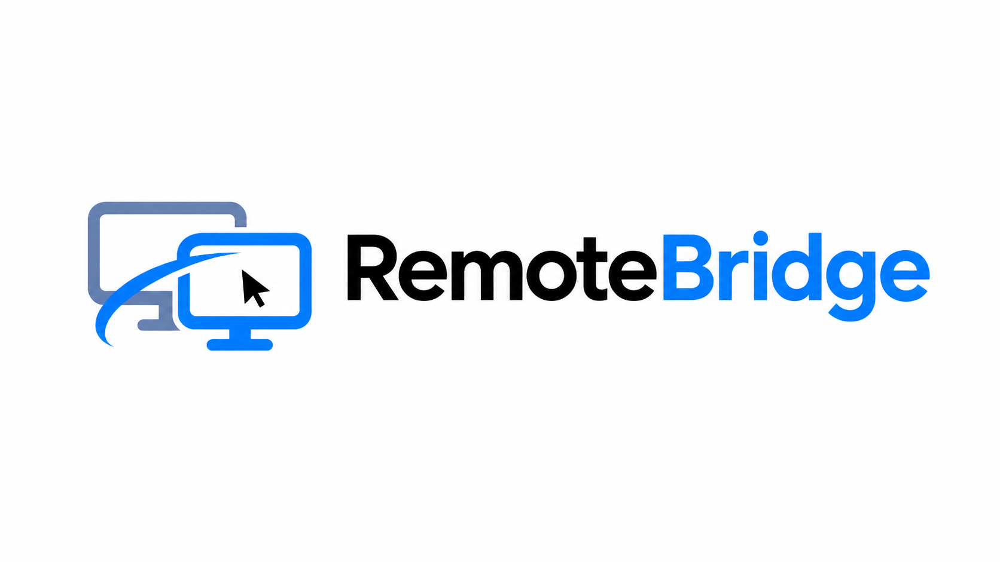
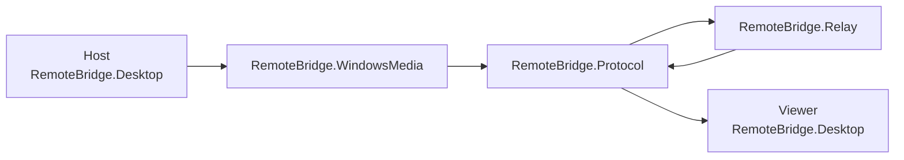

<p align="center">
  
</p>

# RemoteBridge

RemoteBridge is a Windows remote desktop and screen-sharing application built with .NET, Avalonia UI, Windows Graphics Capture, Media Foundation, Direct3D 11, hardware H.264 encoding/decoding, WebSockets, and native Windows input injection.

The project is designed around a low-latency GPU media pipeline. The Host captures its screen using Windows Graphics Capture, converts frames to NV12 on the GPU, encodes them using a hardware NVIDIA H.264 encoder, sends the encoded stream through a WebSocket relay, and presents decoded GPU frames directly on the Viewer using Direct3D 11.

RemoteBridge also supports remote mouse and keyboard control, fullscreen viewing, configurable stream quality, session codes, start/stop sharing, and clean session teardown.

## Status

**RemoteBridge v1.0.0**

The primary production pipeline is complete and has been tested successfully between two Windows computers.

Verified functionality includes:

- Windows Graphics Capture screen capture
- GPU BGRA → NV12 conversion
- NVIDIA hardware H.264 encoding
- Low-latency H.264 encoder configuration
- WebSocket/Relay H.264 transport
- Microsoft H.264 decoding
- D3D11 GPU-backed decoded frames
- Direct3D 11 presentation
- 1920×1080 at 60 FPS
- 1920×1080 at 30 FPS
- 1280×720 at 60 FPS
- 1280×720 at 30 FPS
- Remote mouse movement
- Remote clicking
- Remote drag operations
- Remote mouse wheel scrolling
- Remote keyboard input
- Fullscreen viewing
- Stop and restart sharing
- Session termination
- Remote-control disabling when sharing stops

---

# Features

## Hardware-Accelerated Screen Sharing

RemoteBridge avoids a traditional screenshot/JPEG streaming architecture.

The production media path remains on the GPU for the performance-critical capture, conversion, encoding, decoding, and presentation stages.

```text
Windows Desktop
      │
      ▼
Windows Graphics Capture
      │
      ▼
D3D11 BGRA Texture
      │
      ▼
D3D11 Video Processor
      │
      ▼
NV12 GPU Texture
      │
      ▼
NVIDIA Hardware H.264 Encoder
      │
      ▼
H.264 Access Units
      │
      ▼
WebSocket / Relay
      │
      ▼
Microsoft H.264 Decoder
      │
      ▼
D3D11 NV12 Decoded Texture
      │
      ▼
D3D11 Video Presenter
      │
      ▼
Viewer Window
```

## Low-Latency H.264

The NVIDIA Media Foundation encoder is configured for low-latency operation.

RemoteBridge enables the Media Foundation low-latency setting so the encoder minimizes additional buffering and frame-reordering delay.

This was an important optimization for interactive remote desktop use, particularly at:

```text
1920 × 1080
60 FPS
```

## Remote Input

RemoteBridge supports sending Viewer input back to the Host.

Supported controls include:

- Mouse movement
- Left mouse button down/up
- Clicking
- Dragging
- Mouse wheel scrolling
- Keyboard key down/up
- Text entry

Mouse movement is coalesced to prevent excessive network traffic while retaining responsive control.

Remote control is automatically disabled when the live stream is paused or stopped.

## Fullscreen

The Viewer can enter fullscreen mode without creating another decoder or video pipeline.

The existing GPU video surface is reused inside the same application window, avoiding unnecessary decoder recreation and reducing the chance of presentation or synchronization errors.

`Ctrl + Shift + F` can be used to exit fullscreen locally.

The `Escape` key remains available for transmission to the remote Host.

---

# Stream Quality Modes

RemoteBridge currently provides four stream profiles.

| Profile | Resolution | Target FPS | H.264 Bitrate |
| --- | ---: | ---: | ---: |
| Balanced | 1280×720 | 30 | 4 Mbps |
| High Quality | 1920×1080 | 30 | 8 Mbps |
| Smooth | 1280×720 | 60 | 6 Mbps |
| High Quality 60 | 1920×1080 | 60 | 12 Mbps |

The selected profile is applied when a new screen-sharing session starts.

For best results, stop screen sharing before switching profiles, select the desired profile, and then start sharing again.

### High Quality 60

Recommended when both machines and the network can comfortably handle 1080p60.

```text
1920×1080
60 FPS
12 Mbps
```

### High Quality

Maintains 1080p resolution while reducing frame rate and bandwidth.

```text
1920×1080
30 FPS
8 Mbps
```

### Smooth

Prioritizes motion responsiveness while using a lower resolution.

```text
1280×720
60 FPS
6 Mbps
```

### Balanced

Reduces both resolution and frame rate for lower-bandwidth environments.

```text
1280×720
30 FPS
4 Mbps
```

---

# Architecture

RemoteBridge is divided into several projects so the UI, transport protocol, Windows-specific media pipeline, and relay service remain separated.



## End-to-End Video Pipeline

```mermaid
flowchart LR
    Desktop["Windows Desktop"]
    WGC["Windows Graphics Capture"]
    BGRA["D3D11 BGRA Texture"]
    Converter["D3D11 Video Processor"]
    NV12["NV12 GPU Texture"]
    Encoder["NVIDIA H.264 Encoder"]
    Packet["H264VideoPacket"]
    WS["WebSocket Relay"]
    Decoder["Microsoft H.264 Decoder"]
    Decoded["D3D11 NV12 Texture"]
    Presenter["D3D11VideoPresenter"]
    Screen["RemoteVideoSurface"]

    Desktop --> WGC
    WGC --> BGRA
    BGRA --> Converter
    Converter --> NV12
    NV12 --> Encoder
    Encoder --> Packet
    Packet --> WS
    WS --> Decoder
    Decoder --> Decoded
    Decoded --> Presenter
    Presenter --> Screen
```



## Remote Input Pipeline

```mermaid
flowchart RL
    ViewerInput["Viewer Mouse / Keyboard"]
    ViewModel["MainWindowViewModel"]
    Client["RelayClient"]
    Relay["WebSocket Relay"]
    HostClient["Host RelayClient"]
    InputService["WindowsInputService"]
    Windows["Windows Input"]

    ViewerInput --> ViewModel
    ViewModel --> Client
    Client --> Relay
    Relay --> HostClient
    HostClient --> InputService
    InputService --> Windows
```



---

# Repository Structure

```text
RemoteBridge/
│
├── src/
│   │
│   ├── RemoteBridge.Desktop/
│   │   ├── Models/
│   │   ├── Services/
│   │   ├── ViewModels/
│   │   ├── Views/
│   │   └── RemoteBridge.Desktop.csproj
│   │
│   ├── RemoteBridge.Protocol/
│   │   └── Shared transport and packet definitions
│   │
│   ├── RemoteBridge.WindowsMedia/
│   │   └── Windows capture, H.264, D3D11 and Media Foundation pipeline
│   │
│   └── RemoteBridge.Relay/
│       └── WebSocket relay server
│
├── README.md
└── .gitignore
```

---

# Important Production Components

## Host Media

### `WindowsGraphicsCaptureService`

Responsible for acquiring Windows desktop frames through Windows Graphics Capture.

It manages:

- Windows Graphics Capture
- D3D11 capture surfaces
- frame-rate gating
- GPU conversion
- hardware encoder input
- H.264 output events

### `D3D11WgcNv12Converter`

Uses the Direct3D 11 video processor to convert captured BGRA textures into NV12 textures suitable for H.264 hardware encoding.

The converter supports configurable target resolution and performs aspect-fit calculations when the captured desktop aspect ratio differs from the encoded output.

### `D3D11Nv12SnapshotPool`

Maintains a reusable pool of GPU NV12 textures used by the asynchronous H.264 encoder.

Texture dimensions are matched to the selected stream quality.

### `NvidiaH264InputProbeSession`

Despite its historical `Probe` name, this class currently provides the production NVIDIA H.264 Media Foundation encoder integration.

Responsibilities include:

- selecting the NVIDIA H.264 hardware MFT
- attaching the D3D11 device manager
- negotiating NV12 input
- negotiating H.264 output
- applying resolution
- applying frame rate
- applying bitrate
- enabling low-latency behavior
- processing asynchronous encoder events
- tracking in-flight GPU snapshots

A future cleanup may rename this class to something such as:

```text
NvidiaH264EncoderSession
```

without changing behavior.

### `H264RelayStreamSession`

Connects the Host media pipeline to the Relay transport.

It preserves H.264 access-unit ordering and uses bounded backpressure rather than arbitrarily discarding already-encoded interdependent H.264 frames.

---

# Viewer Media

### `H264DecoderSession`

Uses the Windows Media Foundation H.264 decoder.

Decoded output remains GPU-backed and uses NV12/D3D11 surfaces instead of copying every frame through the CPU.

### `DecodedFrameTextureInterop`

Obtains the D3D11 texture and subresource metadata from Media Foundation decoded samples.

### `ViewerMediaPipeline`

Coordinates incoming H.264 access units, decoder operation, decoded frames, and presentation.

### `D3D11VideoPresenter`

Presents decoded GPU frames to the Viewer window using Direct3D 11.

### `RemoteVideoSurface`

Avalonia `NativeControlHost` integration that provides the native Windows HWND required by the D3D11 presentation pipeline.

It also participates in remote pointer/input handling.

---

# Network and Protocol

RemoteBridge uses a WebSocket relay between the Host and Viewer.

The Relay does not perform video encoding or decoding.

Its job is to move RemoteBridge protocol messages between connected peers.

The production video path uses:

```text
H264VideoPacket
```

to carry encoded H.264 access units and associated metadata such as:

```text
Timestamp
Width
Height
Encoded bytes
```

The current transport uses the existing generic screen-frame transport envelope for the H.264 packet payload.

---

# Backpressure Strategy

Remote desktop streaming must prioritize current visual state instead of building an increasingly delayed frame queue.

RemoteBridge therefore uses bounded queues and backpressure.

The general strategy is:

```text
Raw capture
    ↓
Prefer recent frames
    ↓
Encode selected frame
    ↓
Preserve encoded H.264 order
    ↓
Transmit
    ↓
Decode
    ↓
Present recent visible frame
```

Raw frames may be skipped before encoding when the media pipeline cannot keep up.

Already-encoded H.264 P-frames are not arbitrarily dropped because later frames may depend on them.

---

# Technology Stack

| Technology | Purpose |
| --- | --- |
| C# | Primary application language |
| .NET 10 | Application runtime/framework |
| Avalonia UI | Cross-platform desktop UI framework |
| Windows Graphics Capture | High-performance Windows desktop capture |
| Direct3D 11 | GPU textures, conversion and presentation |
| DXGI | GPU/device/swap-chain interoperability |
| Media Foundation | H.264 encoder/decoder integration |
| NVIDIA H.264 MFT | Host hardware video encoding |
| Microsoft H.264 Decoder MFT | Viewer H.264 decoding |
| NV12 | GPU video pixel format |
| WebSockets | Real-time Host/Viewer transport |
| Vortice.Direct3D11 | .NET Direct3D 11 bindings |
| Vortice.DXGI | .NET DXGI bindings |
| Vortice.MediaFoundation | .NET Media Foundation bindings |
| SharpGen.Runtime | Native COM/runtime interoperability |
| CommunityToolkit.Mvvm | MVVM commands and observable state |

---

# System Requirements

## Host

The current production Host media implementation requires:

- Windows
- Windows Graphics Capture support
- Direct3D 11 capable GPU
- NVIDIA GPU with a compatible hardware H.264 Media Foundation encoder
- network access to the RemoteBridge Relay

## Viewer

The Viewer requires:

- Windows
- Direct3D 11 capable graphics
- compatible Media Foundation H.264 decoder
- network access to the RemoteBridge Relay

## Development

Building from source requires:

```text
.NET SDK 10
Git
```

The project currently targets:

```text
net10.0-windows
```

The application has been developed from macOS while cross-targeting Windows and tested at runtime on Windows machines.

---

# Clone the Repository

```bash
git clone \
https://github.com/YOUR-USERNAME/RemoteBridge.git

cd RemoteBridge
```

Replace `YOUR-USERNAME` with the GitHub account that owns the repository.

---

# Restore Dependencies

From the repository root:

```bash
dotnet restore
```

---

# Build the Windows Desktop Application

```bash
dotnet build \
src/RemoteBridge.Desktop/RemoteBridge.Desktop.csproj \
-f net10.0-windows
```

A successful build should include:

```text
RemoteBridge.Protocol succeeded
RemoteBridge.WindowsMedia succeeded
RemoteBridge.Desktop succeeded

Build succeeded
```

---

# Run the Relay Server

The Relay coordinates communication between Host and Viewer.

Run:

```bash
dotnet run \
--project src/RemoteBridge.Relay \
--urls http://0.0.0.0:5080
```

The WebSocket endpoint is:

```text
ws://HOSTNAME-OR-IP:5080/ws
```

For example:

```text
ws://192.168.1.50:5080/ws
```

The Host and Viewer must both be able to reach the Relay machine.

If developing from macOS and using the Mac as the Relay server, the local Wi-Fi IP can usually be obtained with:

```bash
ipconfig getifaddr en0
```

Then use:

```text
ws://MAC-IP:5080/ws
```

on both Windows computers.

---

# Running RemoteBridge

Start the RemoteBridge desktop application on both Windows PCs.

## Host

On the computer that will be controlled:

1. Launch RemoteBridge.
2. Configure the Relay address if necessary.
3. Create a session.
4. Copy the generated session code.
5. Give the code to the Viewer.
6. Approve the incoming Viewer connection.
7. Select a stream-quality profile.
8. Click **Start Sharing**.

## Viewer

On the computer controlling the Host:

1. Launch RemoteBridge.
2. Connect to the same Relay.
3. Enter the Host's session code.
4. Click **Connect**.
5. Wait for Host approval.
6. The remote desktop will appear when the Host starts sharing.
7. Click the remote screen to give it input focus.

The Viewer can then use mouse, scrolling, clicking, dragging, and keyboard input remotely.

---

# Stop and Restart Sharing

The Host can stop screen sharing without ending the entire session.

When sharing stops:

```text
Video becomes paused
Remote control is disabled
Last displayed frame may remain visible
```

The Host can later press **Start Sharing** again to recreate the media session and resume remote control.

---

# Fullscreen Mode

The Viewer can enter fullscreen while retaining the existing decoder and GPU presentation pipeline.

Use:

```text
Ctrl + Shift + F
```

to exit fullscreen locally.

The normal `Escape` key is intentionally left available for the remote computer.

---

# Build a Release

To create a self-contained 64-bit Windows release:

```bash
dotnet publish \
src/RemoteBridge.Desktop/RemoteBridge.Desktop.csproj \
-c Release \
-f net10.0-windows \
-r win-x64 \
--self-contained true \
-p:PublishSingleFile=true \
-p:IncludeNativeLibrariesForSelfExtract=true \
-p:PublishTrimmed=false \
-o ./artifacts
```

The resulting application will be placed under:

```text
artifacts/
```

The main executable is expected to be:

```text
RemoteBridge.Desktop.exe
```

Because the build is self-contained, users do not need to separately install the matching .NET runtime.

---

# Downloading a Prebuilt Release

For users who do not want to build RemoteBridge from source:

1. Open the GitHub repository.
2. Select **Releases**.
3. Open the latest release.
4. Download the Windows x64 ZIP.
5. Extract the ZIP.
6. Launch `RemoteBridge.Desktop.exe`.

Example release package:

```text
RemoteBridge-v1.0.0-win-x64.zip
```

The Relay service must still be available and reachable by both Host and Viewer.

---

# Creating a GitHub Release

First create the self-contained build:

```bash
dotnet publish \
src/RemoteBridge.Desktop/RemoteBridge.Desktop.csproj \
-c Release \
-f net10.0-windows \
-r win-x64 \
--self-contained true \
-p:PublishSingleFile=true \
-p:IncludeNativeLibrariesForSelfExtract=true \
-p:PublishTrimmed=false \
-o ./artifacts
```

Package it:

```bash
zip -r \
RemoteBridge-v1.0.0-win-x64.zip \
artifacts
```

Tag the release:

```bash
git tag -a v1.0.0 \
-m "RemoteBridge v1.0.0"

git push origin v1.0.0
```

Then on GitHub:

```text
Repository
→ Releases
→ Draft a new release
→ Select v1.0.0
→ Upload RemoteBridge-v1.0.0-win-x64.zip
→ Publish release
```

---

# Development Notes

RemoteBridge originally used a series of independent media probes to validate each Windows media component before integrating them into the application.

The completed probe work proved:

```text
Windows Graphics Capture
D3D11 device creation
DXGI device manager
GPU BGRA → NV12 conversion
NVIDIA H.264 encoding
H.264 Media Foundation negotiation
Microsoft H.264 decoding
D3D11-backed decoded output
GPU presentation
```

After the independent pipeline was proven, the components were integrated into the production Host and Viewer paths.

Legacy JPEG, test transport, and probe-only application paths were subsequently removed from the production desktop application.

---

# Design Goals

RemoteBridge prioritizes:

- Low interaction latency
- GPU-based media processing
- Minimal CPU frame copying
- Ordered H.264 delivery
- Bounded backpressure
- Responsive mouse and keyboard input
- Clean stream lifecycle management
- Simple Host/Viewer workflow
- Separation between media, UI, protocol, and relay components

---

# Known Platform Scope

RemoteBridge's current production media and remote-input implementation is focused on Windows.

The Avalonia UI framework itself supports multiple operating systems, but the production capture, H.264 hardware pipeline, D3D11 presenter, and native remote input components are Windows-specific.

Multi-monitor streaming is not currently implemented.

---

# Troubleshooting

## The application builds but screen sharing does not start

Verify that:

```text
The Host is running Windows.
Windows Graphics Capture is supported.
The Host has a compatible NVIDIA GPU.
The NVIDIA H.264 hardware encoder is available.
Both computers can reach the Relay.
```

## Viewer connects but no video appears

Check:

```text
Host has clicked Start Sharing.
Host and Viewer are connected to the same Relay.
Firewall rules allow Relay traffic.
RemoteBridge did not write remote-media-error.txt.
```

`remote-media-error.txt` may be generated if the Viewer GPU/media pipeline encounters a fatal error.

## High latency

The production NVIDIA encoder uses Media Foundation low-latency mode.

If modifying the media pipeline, make sure low-latency configuration is retained. Removing it can introduce additional codec buffering or frame-reordering delay.

Avoid replacing the encoded H.264 queue with arbitrary frame dropping. Inter-frame H.264 frames may depend on previous encoded frames.

## Stream quality changes do not take effect immediately

Stop the current stream, select another quality mode, and start sharing again.

A new H.264 encoder session is created using the selected settings.

---

# Security Considerations

RemoteBridge provides remote mouse and keyboard control of another Windows computer.

Only connect to computers and Relays that you trust.

Before using RemoteBridge outside a trusted development or local network, additional production security work should be considered, including:

```text
TLS / WSS
Authentication
Relay authorization
Session expiration
Rate limiting
Secure code generation
Encryption configuration
Audit logging
Signed application binaries
Automatic updates
```

The current project should not be treated as a replacement for a security-audited commercial remote-access product without evaluating those areas.

---

# Performance

The completed pipeline has successfully demonstrated:

```text
1920×1080 @ 60 FPS
GPU screen capture
GPU color conversion
Hardware H.264 encoding
GPU-backed H.264 decoding
D3D11 presentation
Interactive remote mouse and keyboard control
```

Actual performance depends on:

```text
Host GPU
Viewer GPU
Network bandwidth
Network latency
Relay location
Selected quality profile
Desktop motion/content
```

---

# Future Enhancements

Possible future development areas include:

- TLS/WSS Relay transport
- Authentication
- Relay deployment
- Automatic Relay discovery
- Clipboard synchronization
- File transfer
- Audio streaming
- Multi-monitor support
- Dynamic bitrate adaptation
- Automatic network-quality selection
- Hardware encoder support beyond NVIDIA
- Viewer scaling controls
- Signed installer
- Automatic updates
- Connection statistics
- Latency telemetry

---

# Version

Current release:

```text
RemoteBridge v1.0.0
```

Target framework:

```text
.NET 10
net10.0-windows
```

---

# License

Add the license that best matches how you want RemoteBridge to be used.

For an open-source project, common options include:

```text
MIT
Apache-2.0
GPL-3.0
```

If you have not selected a license yet, do not assume that publishing the source automatically grants unrestricted reuse. Add a `LICENSE` file before promoting the repository as an open-source project.

---

# Author

Developed as a high-performance Windows remote desktop and systems/media engineering project.

The project demonstrates practical work with:

```text
C#
.NET
Avalonia
Windows APIs
COM interoperability
Media Foundation
Direct3D 11
DXGI
hardware video encoding
video decoding
WebSockets
MVVM
asynchronous pipelines
backpressure
real-time remote input
```

---

# Summary

RemoteBridge combines a native Windows GPU media pipeline with an Avalonia desktop application and WebSocket Relay architecture.

Its production path is:

```text
Host
Windows Graphics Capture
        ↓
D3D11 BGRA
        ↓
GPU NV12 conversion
        ↓
Low-latency NVIDIA H.264
        ↓
WebSocket Relay
        ↓
Microsoft H.264 decoder
        ↓
D3D11 NV12
        ↓
GPU presenter
        ↓
Viewer
```

Remote input travels in the opposite direction:

```text
Viewer
Mouse / Keyboard
        ↓
WebSocket Relay
        ↓
WindowsInputService
        ↓
Host
```

The result is a working low-latency Windows remote desktop application with configurable 720p/1080p and 30/60 FPS streaming profiles.
